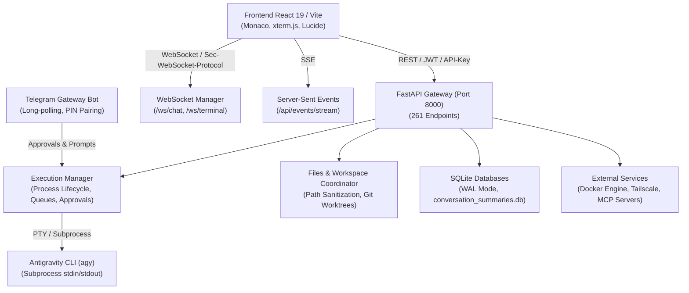

# Rapport d'Audit Technique Approfondi — Antigravity WebUI

**Dépôt :** `https://github.com/jprud67/antigravity-webui`  
**Branche auditée :** `main` (commit `98bb4ad`)  
**Type d'audit :** Audit technique complet, architectural, de sécurité et d'exploitabilité  
**Date d'audit :** Octobre 2026  
**Auditeur :** Antigravity AI Senior Systems Auditor  

---

## 1. Résumé Exécutif & Diagnostic Global

Le projet **Antigravity WebUI** constitue une interface web complète et avancée pour orchestrer l'agent autonome Google Antigravity CLI (`agy`). Il intègre :
- Un backend haute performance basé sur **FastAPI** (93 modules Python, 261 routes d'API REST et WebSockets, 664 tests unitaires).
- Un frontend moderne et réactif basé sur **React 19**, **TypeScript 5.7**, **Vite 6** et **Tailwind CSS 3.4** (97 composants et vues, compilation complète en production en 21.7s).
- Une suite complète d'outils pour développeurs : terminal interactif PTY xterm.js, éditeur de code Monaco avec diagnostics LSP, studio de base de données SQLite, studio Docker, client Git avancé avec branches et worktrees, passerelle bot Telegram avec appairage par code PIN, et intégrations MCP (Model Context Protocol).

### Diagnostic Global
L'architecture logicielle générale est particulièrement riche, bien modélisée et démontre un haut niveau de conception. La grande majorité des points d'entrée critiques (navigation dans les fichiers, manipulation de code, actions Git) intègre des contrôles de sécurité stricts (vérification de `is_blocked_sensitive_path`, validation des noms de branches Git avec `check-ref-format`, protection CSRF/Origin sur les WebSockets).

Cependant, l'audit a mis en lumière **11 anomalies concrètes**, dont **1 bogue logique et runtime critique** dans la passerelle Telegram (empêchant l'approbation d'actions et inversant les décisions), **1 échec unitaire confirmé** dans l'API de téléchargement de fichiers, et **1 défaut de sécurité significatif** (omission d'authentification sur les modules Plugins, Watchdog et Maintenance Sweeps).

| Domaine Évalué | Note / Statut | Appréciation |
|---|---|---|
| **Architecture Globale** | **8.5 / 10** | Excellente séparation des responsabilités, pipeline asynchrone robuste. |
| **API REST & Contrats** | **8.0 / 10** | 261 endpoints bien documentés, mais quelques routeurs sans auth globale. |
| **Sécurité & Périmètre** | **7.5 / 10** | Filtrage solide des chemins système sensibles, mais endpoints sweeps/watchdog ouverts. |
| **Stabilité Runtime & Concurrence** | **7.0 / 10** | Concurrence SQLite en WAL bien menée ; kernel Python in-process vulnérable aux boucles infinies. |
| **Frontend & UX** | **9.0 / 10** | Interface réactive, 0 erreur TypeScript, 6 avertissements mineurs React 19. |
| **Couverture & Tests** | **8.5 / 10** | 662 tests passants, 1 échec unitaire (BUG-002), 1 mock non autospeccé (BUG-001). |

---

## 2. Cartographie de l'Architecture et des Dépendances

### 2.1. Modules Clés et Responsabilités

1. **`backend/app/services/execution_manager.py` (72 Ko) :**
   - Cœur névralgique de l'application : gère le cycle de vie des sessions de l'agent Antigravity CLI, les files de messages asynchrones (`asyncio.Queue`), la capture du streaming de réflexion/pensée, les requêtes d'approbation d'outils sensibles (`pending_approval`), et la diffusion en temps réel (`broadcast`) à tous les souscripteurs connectés.
2. **`backend/app/services/telegram_gateway.py` (35 Ko) :**
   - Passerelle bidirectionnelle avec Telegram : écoute en long-polling, gestion de l'appairage par PIN temporaire stocké dans SQLite, notifications push d'état de l'agent, et boutons de validation/rejet d'actions d'outils.
3. **`backend/app/api/files.py` (48 Ko) :**
   - Gestionnaire de fichiers : lecture, écriture, recherche globale (ripgrep/regex), streaming de téléchargement avec archivage zip à la volée.
4. **`backend/app/api/git.py` (95 Ko) :**
   - Client Git complet : staging, commits, gestion des branches, fusions, tags, stash, et comparaison inter-branches.
5. **`backend/app/services/code_kernel.py` (13 Ko) :**
   - Exécuteur de cellules de code Python avec persistance de l'espace de noms (globals) et proxy d'outils.
6. **`backend/app/services/storage.py` et `database_studio.py` :**
   - Persistance SQLite, historique des conversations, recherche plein texte FTS5, et studio d'introspection/requêtage SQL.

---

## 3. Analyse Détaillée des Paliers Techniques

### 3.1. Sécurité et Contrôle d'Accès (RBAC)

#### Points Forts Identifiés
- **Filtrage des chemins système (`is_blocked_sensitive_path`) :**
  Implémentation exemplaire dans `backend/app/platform_utils.py` : interdiction formelle d'accéder aux chemins sensibles (`/etc`, `/proc`, `/sys`, `~/.ssh`, `~/.aws`, `~/.gnupg`, etc.), avec résolution stricte des liens symboliques (`Path.resolve()`).
- **Protection contre les attaques de traversée (`is_safe_path`) :**
  Vérification systématique de l'appartenance d'un chemin cible à la liste blanche des répertoires de workspace autorisés (`get_allowed_workspace_roots()`).
- **Validation Git stricte :**
  Les noms de branches injectés dans les commandes Git sont validés par regex stricte et par l'utilitaire officiel `git check-ref-format --branch`.
- **Authentification Hybride :**
  Support des jetons JWT Bearer, des clés d'API statiques et du sous-protocole WebSocket `Sec-WebSocket-Protocol: token.<base64>`.

#### Vulnérabilités Confirmées
- **Omission d'authentification sur 3 routeurs (BUG-003) :**
  Dans `backend/app/api/plugins.py`, les routeurs `/api/plugins`, `/api/watchdog` et `/api/sweeps` ne disposent d'aucun `Depends(require_auth)`. Des opérations administratives telles que le lancement de balayages de maintenance ou la modification d'alertes sont directement exposées.
- **Identité Git codée en dur (BUG-006) :**
  L'identité de l'auteur et du commiteur Git est fixée à `jprud67` dans `git.py` et `updater.py`, interdisant l'utilisation multi-utilisateurs et compromettant la traçabilité.

---

### 3.2. Persistance et Concurrence SQLite

#### Évaluation Concurrence & WAL Mode
Le projet utilise SQLite (`conversation_summaries.db`) comme base de métadonnées principale.
- **Journal Mode :** Le mode WAL (`PRAGMA journal_mode=WAL`) est correctement activé dans la majorité des services (`storage.py`, `vector_memory.py`, `kanban.py`, etc.).
- **Timeouts :** Un timeout de connexion explicite (`timeout=15.0`) est configuré pour prévenir les verrous `database is locked` lors d'écritures concurrentes.
- **Faiblesse identifiée (BUG-011) :**
  Certains modules (`maintenance_sweeps.py`, `watchdog_sentinel.py`) n'utilisent pas la base SQLite et conservent leurs alertes et leur historique dans de simples listes Python en mémoire (`_sweep_history`), provoquant la perte de données à chaque redémarrage du processus.

---

### 3.3. Gestion des Processus et du Kernel Python

#### Évaluation de `PersistentPythonKernel` (BUG-004 & BUG-008)
L'implémentation actuelle présente un risque architectural significatif :
1. **Absence d'isolation :** Le code utilisateur est exécuté directement dans le processus parent FastAPI via `exec()`.
2. **Impuissance face aux boucles infinies :** L'arrêt par timeout repose sur `threading.Thread.join(timeout)`. Les threads en boucle infinie continuent de tourner indéfiniment en tâche de fond, saturant les cœurs CPU du serveur.
3. **Redirection globale de stdout :** Le remplacement temporaire de `sys.stdout` sous un verrou global pollue les sorties d'exécution avec les logs système du serveur et bloque l'exécution concurrente de cellules.

---

### 3.4. Passerelle Telegram & Circuit d'Approbation (BUG-001)

L'audit approfondi du module `telegram_gateway.py` a mis en lumière un bogue de sévérité critique :
- **Inadéquation de signature :** `handle_approval` attend obligatoirement 3 arguments positionnels (`conversation_id`, `decision`, `rule`). Le bot Telegram n'en transmet que 2, déclenchant une exception `TypeError` à chaque tentative de validation d'un outil par l'utilisateur.
- **Inversion logique :** Quand bien même l'argument manquant serait omis via une valeur par défaut, le terme `"approved"` utilisé par Telegram n'est pas reconnu par `execution_manager.py` (qui attend `"allow-once"`, `"allow-session"` ou `"always-allow"`), envoyant systématiquement `"n\n"` (refus) au sous-processus CLI tout en affichant un message de succès à l'opérateur.

---

### 3.5. Frontend, Expérience Utilisateur et React 19

Le frontend développé en React 19 et Vite est remarquable par sa propreté de typage (0 erreur de compilation TypeScript `tsc`).
- **Analyse Oxlint :** Révèle 6 avertissements de performance (`set-state-in-effect` et `exhaustive-deps`) dans `WorkspacePanel.tsx`, `ProjectSwitcherModal.tsx` et `FileExplorerModal.tsx`.
- **Fonctionnalités simulées (BUG-005) :** Le catalogue de plugins communautaires (`PluginCatalogModal.tsx`) affiche des outils d'apparence opérationnels (*Prettier*, *Security Scanner*, *Git Lens*) qui ne sont en réalité que des bouchons statiques côté backend.

---

## 4. Synthèse des Risques et Recommandations Prioritaires

| Risque Identifié | Impact Métier / Technique | Priorité |
|---|---|---|
| Défaillance du flux d'approbation Telegram (BUG-001) | Blocage ou refus silencieux d'actions autorisées par l'opérateur | **P0 (Immédiate)** |
| Endpoints administratifs non protégés (BUG-003) | Exécution non autorisée de scans et commandes système | **P0 (Immédiate)** |
| Régression suite de tests sur `download_file` (BUG-002) | Téléchargements erronés ou échecs CI/CD | **P1 (Haute)** |
| Déni de service CPU sur le noyau Python (BUG-004) | Saturation de la machine hôte par threads orphelins | **P1 (Haute)** |
| Signature Git forcée à `jprud67` (BUG-006) | Perte d'attribution et d'identité dans les commits | **P1 (Haute)** |
| Contrats de typage rompus / 12 erreurs Mypy (BUG-007) | Instabilité et non-respect des protocoles asynchrones | **P2 (Moyenne)** |
| Plugins affichés mais non implémentés (BUG-005) | Tromperie UX sur les capacités de la plateforme | **P2 (Moyenne)** |
| Volatilité des alertes Watchdog et Sweeps (BUG-011) | Perte de traçabilité des failles de sécurité après reboot | **P3 (Basse)** |
