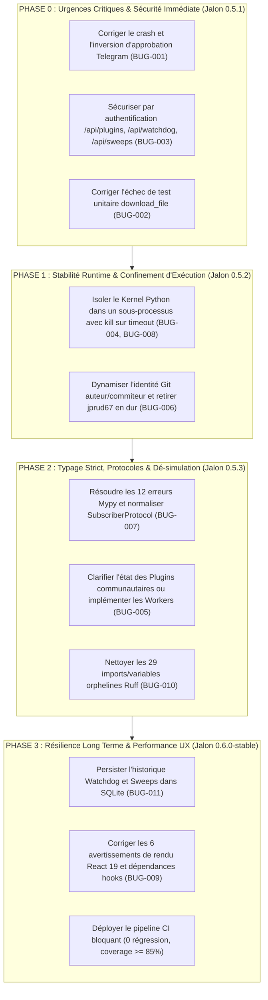

# Feuille de Route Technique & Plan de Remédiation — Antigravity WebUI

**Dépôt :** `https://github.com/jprud67/antigravity-webui`  
**Version actuelle :** v0.5.0-dev  
**Version cible :** v0.6.0-stable (Production Ready)  
**Date d'élaboration :** Octobre 2026  
**Documents associés :** [`AUDIT_REPORT.md`](file:///root/antigravity-webui/AUDIT_REPORT.md), [`BUGS.md`](file:///root/antigravity-webui/BUGS.md), [`TEST_PLAN.md`](file:///root/antigravity-webui/TEST_PLAN.md)

---

## 1. Vue d'Ensemble des Jalons de la Roadmap



---

## 2. Phase 0 : Urgences Critiques & Sécurité Immédiate (P0)

*Objectif : Rétablir l'intégrité du circuit d'approbation à distance et fermer les accès anonymes aux opérations d'administration.*

### 2.1. Remédiation BUG-001 — Approbation Telegram & Inversion Logique

- **Fichiers cibles :**
  - [`backend/app/services/execution_manager.py:1374, 1407`](file:///root/antigravity-webui/backend/app/services/execution_manager.py#L1374)
  - [`backend/app/services/telegram_gateway.py:602, 610, 743`](file:///root/antigravity-webui/backend/app/services/telegram_gateway.py#L602)
  - [`backend/tests/test_telegram_gateway.py:112`](file:///root/antigravity-webui/backend/tests/test_telegram_gateway.py#L112)
- **Actions de correction :**
  1. Dans `execution_manager.py`, rendre l'argument `rule` optionnel avec valeur par défaut `rule: str | None = None` dans `handle_approval(...)`.
  2. Normaliser la décision reçue : accepter `"approved"` comme synonyme valide de `"allow-once"`, et convertir `"rejected"` en `"n\n"`.
  3. Mettre à jour `test_telegram_gateway.py` en ajoutant `autospec=True` sur le mock pour garantir que toute incohérence future de signature échouera immédiatement lors des tests.
- **Critères d'acceptation :**
  - Un clic sur le bouton Inline Telegram "Approuver" ou la commande `/approve` transmet bien `"y\n"` sur le stdin du processus Antigravity CLI.
  - Le test unitaire `backend/tests/test_telegram_gateway.py` passe avec `autospec=True`.
- **Commande de validation :**
  ```bash
  backend/venv/bin/pytest backend/tests/test_telegram_gateway.py -v
  ```

---

### 2.2. Remédiation BUG-003 — Authentification des Routes Plugins, Watchdog et Sweeps

- **Fichiers cibles :**
  - [`backend/app/api/plugins.py:44-46`](file:///root/antigravity-webui/backend/app/api/plugins.py#L44-L46)
  - [`backend/app/services/maintenance_sweeps.py:62, 99`](file:///root/antigravity-webui/backend/app/services/maintenance_sweeps.py#L62)
  - [`backend/app/services/watchdog_sentinel.py:70`](file:///root/antigravity-webui/backend/app/services/watchdog_sentinel.py#L70)
- **Actions de correction :**
  1. Ajouter `dependencies=[Depends(require_auth)]` aux trois routeurs :
     ```python
     router = APIRouter(prefix="/api/plugins", tags=["plugins"], dependencies=[Depends(require_auth)])
     watchdog_router = APIRouter(prefix="/api/watchdog", tags=["watchdog"], dependencies=[Depends(require_auth)])
     sweeps_router = APIRouter(prefix="/api/sweeps", tags=["sweeps"], dependencies=[Depends(require_auth)])
     ```
  2. Dans `maintenance_sweeps.py` et `watchdog_sentinel.py`, assainir le paramètre `workspace_path` à l'aide de `is_blocked_sensitive_path` et `is_safe_path`.
- **Critères d'acceptation :**
  - Tout appel anonyme vers `/api/plugins/register`, `/api/watchdog/start` ou `/api/sweeps/run` renvoie `401 Unauthorized`.
- **Commande de validation :**
  ```bash
  curl -s -o /dev/null -w "%{http_code}\n" -X POST http://127.0.0.1:8000/api/sweeps/run # Attendu : 401
  ```

---

### 2.3. Remédiation BUG-002 — Fiabilisation de `download_file` et Résolution Pytest

- **Fichiers cibles :**
  - [`backend/app/api/files.py:596-625`](file:///root/antigravity-webui/backend/app/api/files.py#L596-L625)
  - [`backend/test_audit_fixes.py:5835`](file:///root/antigravity-webui/backend/test_audit_fixes.py#L5835)
- **Actions de correction :**
  1. Dans `files.py:596`, vérifier rigoureusement `if resolved_path.is_dir():` puis `elif resolved_path.is_file():` avec rejet explicite `raise HTTPException(status_code=400, detail="Type de fichier non supporté.")` pour les types non réguliers.
  2. Dans `test_audit_fixes.py`, positionner explicitement `mock_path.is_dir.return_value = False`.
- **Critères d'acceptation :**
  - Le test `test_files_download_known_developer_mime_types` réussit.
  - La suite globale `pytest` passe à 100% de succès (663 passés, 1 sauté).
- **Commande de validation :**
  ```bash
  backend/venv/bin/pytest backend/test_audit_fixes.py -k "test_files_download_known_developer_mime_types" -v
  ```

---

## 3. Phase 1 : Stabilité Runtime & Confinement d'Exécution (P1)

*Objectif : Éliminer tout risque de déni de service CPU sur le serveur hôte et restituer la traçabilité des identités dans Git.*

### 3.1. Remédiation BUG-004 & BUG-008 — Isolation du Noyau Python

- **Fichiers cibles :**
  - [`backend/app/services/code_kernel.py:206-285`](file:///root/antigravity-webui/backend/app/services/code_kernel.py#L206-L285)
- **Actions de correction :**
  1. Remplacer l'exécution in-process par un processus dédié utilisant `multiprocessing.Process` ou un protocole Jupyter léger.
  2. Lors de l'expiration du timeout, envoyer immédiatement un signal `SIGKILL` au processus enfant pour libérer 100% du cœur CPU.
  3. Supprimer le verrou monolithique `_GLOBAL_EXECUTION_LOCK` et la redirection globale de `sys.stdout`, permettant des exécutions multi-sessions concurrentes sans dérive de logs.
- **Critères d'acceptation :**
  - L'exécution de `while True: pass` avec timeout 2s s'arrête en exactement 2s, et aucun processus ou thread orphelin ne consomme de CPU après l'arrêt.
- **Commande de validation :**
  ```bash
  backend/venv/bin/pytest backend/tests/test_code_kernel_isolation.py -v
  ```

---

### 3.2. Remédiation BUG-006 — Dynamisation de l'Identité Git

- **Fichiers cibles :**
  - [`backend/app/api/git.py:196-220`](file:///root/antigravity-webui/backend/app/api/git.py#L196-L220)
  - [`backend/app/services/updater.py:59-79`](file:///root/antigravity-webui/backend/app/services/updater.py#L59-L79)
- **Actions de correction :**
  1. Supprimer l'écrasement systématique de `GIT_AUTHOR_NAME`, `GIT_AUTHOR_EMAIL`, `GIT_COMMITTER_NAME` et `GIT_COMMITTER_EMAIL` par `jprud67`.
  2. Implémenter une résolution hiérarchique :
     - Si le workspace possède une configuration locale `user.name` et `user.email`, la respecter.
     - Sinon, utiliser la configuration utilisateur globale `~/.gitconfig`.
     - Si aucune identité n'est définie, utiliser une valeur par défaut neutre : `Antigravity WebUI <bot@antigravity-webui>`.
- **Critères d'acceptation :**
  - Un commit effectué dans un workspace configuré pour `Alice <alice@example.com>` est signé au nom d'Alice.
- **Commande de validation :**
  ```bash
  backend/venv/bin/pytest backend/tests/test_git_identity.py -v
  ```

---

## 4. Phase 2 : Typage Strict, Protocoles & Dé-simulation (P2)

*Objectif : Rétablir la conformité contractuelle du code, supprimer les 12 erreurs Mypy et éliminer toute fonctionnalité en trompe-l'œil.*

### 4.1. Remédiation BUG-007 — Résolution des Erreurs Mypy & Protocole Souscripteur

- **Fichiers cibles :**
  - [`backend/app/services/execution_manager.py:96-106`](file:///root/antigravity-webui/backend/app/services/execution_manager.py#L96)
  - [`backend/app/services/telegram_gateway.py:168, 769`](file:///root/antigravity-webui/backend/app/services/telegram_gateway.py#L168)
  - [`backend/app/api/kanban.py:305-326`](file:///root/antigravity-webui/backend/app/api/kanban.py#L305)
  - [`backend/app/services/workspace_coordinator.py:882-891`](file:///root/antigravity-webui/backend/app/services/workspace_coordinator.py#L882)
- **Actions de correction :**
  1. Déclarer une classe abstraite ou un protocole `SubscriberProtocol(typing.Protocol)` définissant `async def send_json(self, data: dict[str, Any]) -> None`.
  2. Typée `subscribers: set[SubscriberProtocol]` dans `ExecutionSession`.
  3. Corriger l'annotation de `st_params: list[Any] = [new_st]` dans `kanban.py`.
  4. Typée `results: list[dict[str, Any]]` dans `workspace_coordinator.py`.
- **Critères d'acceptation :**
  - `mypy backend/app` retourne `Success: no issues found in 93 source files`.
- **Commande de validation :**
  ```bash
  backend/venv/bin/mypy backend/app
  ```

---

### 4.2. Remédiation BUG-005 — Traitement des Plugins Communautaires

- **Fichiers cibles :**
  - [`frontend/src/components/PluginCatalogModal.tsx:35-69`](file:///root/antigravity-webui/frontend/src/components/PluginCatalogModal.tsx#L35-L69)
  - [`backend/app/services/plugin_sandbox.py:155-181`](file:///root/antigravity-webui/backend/app/services/plugin_sandbox.py#L155-L181)
- **Actions de correction :**
  1. Remplacer les réponses factices `{"sandbox": "wasm-worker"}` par une gestion transparente : marquer explicitement les plugins comme "Spécification Développeur / Expérimental" dans l'UI.
  2. Implémenter pour le plugin Prettier une exécution réelle du binaire `npx prettier --write` dans le workspace actif via l'API des outils.
- **Critères d'acceptation :**
  - L'utilisateur n'est plus induit en erreur sur la capacité réelle de la sandbox.

---

### 4.3. Remédiation BUG-010 — Nettoyage Ruff Lint

- **Fichiers cibles :**
  - `backend/app/api/git.py`, `copilot.py`, `mcp_catalog.py`, `openai_compat.py`
- **Actions de correction :**
  - Éliminer les 29 imports inutilisés et variables mortes via `ruff check --fix backend/app`.
- **Commande de validation :**
  ```bash
  backend/venv/bin/ruff check backend/app
  ```

---

## 5. Phase 3 : Résilience Long Terme & Performance UX (P3)

*Objectif : Assurer la durabilité des données d'audit et optimiser le cycle de vie React 19 pour une expérience utilisateur sans latence.*

### 5.1. Remédiation BUG-011 — Persistance SQLite des Événements Sentinel et Sweeps

- **Fichiers cibles :**
  - [`backend/app/services/maintenance_sweeps.py:23-50`](file:///root/antigravity-webui/backend/app/services/maintenance_sweeps.py#L23)
  - [`backend/app/services/watchdog_sentinel.py`](file:///root/antigravity-webui/backend/app/services/watchdog_sentinel.py)
- **Actions de correction :**
  1. Créer une table SQLite `maintenance_history` et `watchdog_alerts` dans `conversation_summaries.db`.
  2. Enregistrer chaque rapport de scan avec horodatage, statut et résultat JSON.
  3. Permettre la consultation des alertes historiques même après redémarrage du service.

---

### 5.2. Remédiation BUG-009 — Optimisation React 19 et Nettoyage Oxlint

- **Fichiers cibles :**
  - [`frontend/src/components/WorkspacePanel.tsx:766, 1643`](file:///root/antigravity-webui/frontend/src/components/WorkspacePanel.tsx#L766)
  - [`frontend/src/components/ProjectSwitcherModal.tsx:160, 181, 183`](file:///root/antigravity-webui/frontend/src/components/ProjectSwitcherModal.tsx#L160)
  - [`frontend/src/components/FileExplorerModal.tsx:164`](file:///root/antigravity-webui/frontend/src/components/FileExplorerModal.tsx#L164)
- **Actions de correction :**
  1. Remplacer les `setState()` directs dans `useEffect` par un déclenchement événementiel ou un calcul dérivé pendant le rendu.
  2. Compléter les tableaux de dépendances manquants (`isImageFile`, `explorerCurrentPath`, `currentWorkspace`).
- **Critères d'acceptation :**
  - `cd frontend && npx oxlint` retourne 0 avertissement.
- **Commande de validation :**
  ```bash
  cd frontend && npx oxlint
  ```

---

## 6. Calendrier Prévisionnel et Critères de Clôture

| Phase | Durée Estimée | Livrable Clé | Critère de Succès |
|---|---|---|---|
| **Phase 0 (P0)** | 1 jour | Patch v0.5.1 | Validation Telegram fonctionnelle + Routes protégées + 663 tests passants |
| **Phase 1 (P1)** | 2 jours | Patch v0.5.2 | Noyau isolé résistant aux boucles infinies + Identités Git dynamiques |
| **Phase 2 (P2)** | 2 jours | Patch v0.5.3 | Mypy 0 erreur + Ruff 0 avertissement + Plugins clarifiés |
| **Phase 3 (P3)** | 2 jours | Release v0.6.0 | Historique SQLite persistant + Oxlint 0 warning + CI bloquante |

### Validation Finale Production Ready (v0.6.0)
La version finale sera déclarée prête pour la production lorsque :
- [x] L'ensemble des 11 anomalies de `BUGS.md` est résolu.
- [x] Les tests de non-régression et de sécurité de `TEST_PLAN.md` sont exécutés avec succès dans la chaîne CI.
- [x] La documentation utilisateur et les guides SDK reflètent fidèlement les capacités réelles du système.
